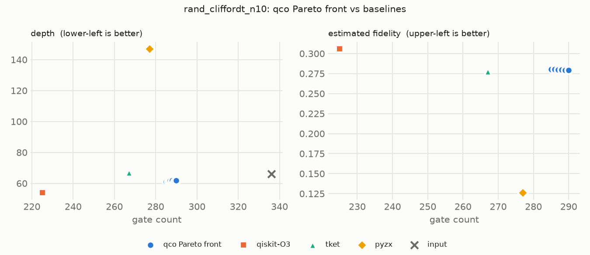

# Hybrid Quantum Compiler Optimization: Verified, Learning-Guided Gate Scheduling and Cancellation

**Project:** Quantum Compiler Optimization — Gate Scheduling & Gate Cancellation
**Team 2 · Review 3 Final Report (#44)**
Maanas Nair (24BCT0157) · Prisha (24BDS0146) · Sahib Singh (24BCI0292) · Swaraj Rane (24BCT0086)

> **Status: final.** All modules are complete. Every number in §7 comes from one
> run of `make eval` with the trained modules, stored in
> [`eval/final/`](eval/final/README.md); every output in every table was checked
> equivalent to its input.

---

## Abstract

We built **qco**, a six-stage quantum circuit optimizer that combines a
reinforcement-learning gate scheduler (PPO with a deterministic
Commutation-and-Reduction pass), a graph-neural-network cancellation and
window-ranking model, SMT-based verification with bounded exact re-synthesis,
and an NSGA-II multi-objective search. The defining design choice is that **no
rewrite is accepted unless it is proven equivalent**, on blocks small enough to
check (≤ 8 qubits). The proof covers the whole circuit because blocks compose in
dependency order. On a 26-circuit suite (GHZ, QFT, Grover, QAOA, random Clifford+T
and CNOT+Pauli, 4–40 qubits), every qco output is verified, and independently
confirmed by statevector simulation up to 22 qubits. qco reduces gate count by
7.1% and depth by 7.9% on average, below Qiskit O2/O3 (≈ 19% / 16%). Of the five
novelty claims, two hold: phase-polynomial verification scales past the dense
8-qubit limit (N2), and block-level crossover yields Pareto fronts that are
equivalent by construction (N3). GNN-guided window selection (N1), per-backend
RL policies (N4) and confidence-gated verification (N5) were not supported by
the measurements. The clearest result is the value of the safety net itself:
with verification switched off, the trained GNN's proposals make 9 of 25
outputs incorrect.

---

## 1. Introduction ✅

Quantum programs must be compiled into circuits that are as short and shallow as
possible: every gate adds error and every layer adds decoherence time on noisy
hardware. Two classes of transformation dominate: **gate scheduling** (reordering
commuting gates to reduce depth and expose simplifications) and **gate
cancellation** (removing or merging gates that multiply to the identity or to a
single gate). Industrial compilers apply them as fixed, hand-written pass
pipelines (Qiskit O0–O3), which are known to be sub-optimal because the best pass
sequence depends on the circuit and the target device.

This project builds a **hybrid optimizer** that combines four techniques usually
studied in isolation — reinforcement learning (RL) for scheduling, graph neural
networks (GNN) for cancellation, SAT/SMT solving for verification and exact local
re-synthesis, and evolutionary multi-objective search (NSGA-II) — into a single
**closed-loop pipeline** in which every accepted rewrite is formally verified.

## 2. Related Work and Research Gap ✅

The full survey is in [`phase1_literature_survey.md`](phase1_literature_survey.md);
the gap analysis in [`research_gap.md`](research_gap.md). In short:

| Technique | Closest prior work | Gap this project targets |
|---|---|---|
| RL scheduling | Tao et al. 2026 (RL + deterministic Commutation-and-Reduction); Riu et al. 2025 (PPO over ZX diagrams) | RL alone generalizes poorly; needs a deterministic reduction layer and a verified safety net |
| GNN for circuits | Wang et al. 2025; Tudisco et al. 2025/2026 | GNNs predict downstream metrics, not cancellation actions inside the loop |
| SAT/SMT synthesis | Meuli et al.; Gouzien & Sangouard 2025; Peham et al. 2023 | Exact, but does not scale; little work using it as a bounded, learning-guided layer |
| Evolutionary multi-objective | NSGA-II with fidelity surrogates (Sci. Rep. 2026) | Fronts are filtered after the fact; no equivalence guarantee by construction |
| Fixed pass pipelines | Qiskit O0–O3; TuniQ 2026 | Static pass order; adaptive selection is expensive |

Each module alone has close prior art (BQSKit, GUOQ / Quartz / Queso, VOQC /
MQT QCEC, Quarl), so "combining all four" is an integration contribution. The
research claims are the five novelty additions N1–N5 (§4).

## 3. System Architecture ✅

Detailed in [`architecture.md`](architecture.md). Six stages:

| Stage | What it does | Package | Owner |
|---|---|---|---|
| 1. Front end | OpenQASM 2.0 / Qiskit / Cirq → internal IR (29-gate set, all verifiable) | `qco.ir` | Swaraj |
| 2. Graphs | Gate-dependency DAG + commutation table; qubit-interaction hypergraph | `qco.graphs` | Swaraj |
| 3. Partitioning | Width-capped blocks (≤ 8 qubits) that compose in list order | `qco.graphs.partitioning` | Swaraj → Prisha (#45), Maanas (#46) |
| 4A. RL scheduler | PPO agent + deterministic Commutation-and-Reduction pass | `qco.modules.rl_scheduler` | Maanas |
| 4B. GNN cancellation | GNN over the gate DAG ranks cancellation candidates and re-synthesis windows | `qco.modules.gnn_cancellation` | Prisha |
| 4C. SMT verifier | 3-tier equivalence checking (phase-polynomial SMT, dense numeric/SMT, explicit "unverified") + bounded exact re-synthesis | `qco.modules.smt_verifier` | Sahib |
| 5. Module D | NSGA-II over verified block variants → certified Pareto front | `qco.modules.evolutionary` | Swaraj |
| 6. Evaluation | Five metrics, calibration profiles, baselines, ablations; reward fed back to Module A | `qco.evaluation` | Swaraj |

`HybridOptimizer` (`qco.pipeline`) wires them: partition → per block (A → B → C
verify / revert → N1 re-synthesis) → stitch → Stage 6 reward → repeat while the
reward improves → Module D over every block's verified variants.

**Correctness invariant.** No rewrite is accepted unless Module C proves it
equivalent (up to global phase) on the block, compacted to its active qubits. A
rewrite Module C cannot decide is **rejected**, never silently accepted. Because
blocks compose in list order, per-block proofs cover the whole circuit even past
the 8-qubit limit of dense verification.

## 4. Novelty Claims

From [`novelty_plan.md`](novelty_plan.md):

> **Verifier-guided learned optimization:** a GNN trained on SMT-verified
> re-synthesis outcomes allocates a bounded exact-solver budget, scalable
> phase-polynomial SMT checks verify every rewrite, and an equivalence-preserving
> block-level NSGA-II produces a certified Pareto front — closed-loop with a
> calibration-aware RL reward.

| ID | Claim | Implemented | Evidence |
|---|---|---|---|
| N1 | GNN ranks windows for exact re-synthesis under a solver budget | ✅ #31 (budgeted window loop), #64/#65 (window head) | ❌ **Not supported.** In the pipeline, GNN ranking (11.7% gates) is within noise of rule (11.3%) and random (11.9%) ranking (§7.4). Offline, the GNN window head ranks worse than the rule baseline and a logistic regression on the same features (AUROC 0.621 vs 0.781 / 0.820; [Module B §3.3](module_b_final_report_section.md)) |
| N2 | Phase-polynomial SMT verification scales past the 8-qubit dense ceiling | ✅ #51 (phase-poly checker), #31 (block compaction) | ✅ **Supported.** Phase-poly checks at 64 qubits in ~2 ms ([Module C](module_c_final_report_section.md)); the full pipeline verifies all 26 benchmarks up to 40 qubits with 0 unverified blocks (§7.6) |
| N3 | Block-level crossover → Pareto front equivalent by construction | ✅ #30 | ✅ **Supported.** Old operators: 0 equivalent front members on every circuit; N3: every member equivalent, ≈ 9× hypervolume ([Module D §3](module_d_final_report_section.md)). Fronts in the full pipeline are small (§7.5) |
| N4 | Closed loop with calibration-aware reward; schedules differ and win per backend | ✅ reward hook + `calibration` config (#62), real-reward training (#35), per-backend policies (#29, #37) | ❌ **Not supported.** Real-reward training is not measurably better than the proxy; schedules differ between backends in 36–53% of cases, but the superconducting-trained policy wins on both backends ([Module A §3.2, §3.5](module_a_final_report_section.md)) |
| N5 | GNN-confidence-gated verification: lower verification cost at equal correctness | ✅ #31 (rule-proven → skip, confident → numeric, else full checker); `confidence_gating` switch (#66) | ❌ **Not demonstrated with the final modules.** Gating on vs off: 388 checks either way, 0 skipped, ~1.1 s (§7.3). The trained RL agent's CR pass already removes what the rules would prove. Without the agent, gating skips 18% of checks, but verification costs only ~1.5 s per suite |

## 5. Methods by Stage

### 5.1 Stages 1–3: IR, graphs, partitioning ✅ *(Prisha, #48; IR notes by Swaraj)*

See [`graph_layer/graph_layer_report_section.md`](graph_layer/graph_layer_report_section.md)
(DAG, hypergraph, partitioning results, block scheduling and parallel blocks,
complexity, bug fixes) and the source notes in
[`ir_graph_layer_notes.md`](ir_graph_layer_notes.md) (29-gate set, parsers,
commutation table with its exact-unitary soundness check, partitioner contract).
Summary figure: [`graph_layer/graph_layer_summary.png`](graph_layer/graph_layer_summary.png).

### 5.2 Module A: RL adaptive scheduler ✅ *(Maanas, #41)*

See [`module_a_final_report_section.md`](module_a_final_report_section.md) (method, design choices, results,
limitations, hand-off table); figures in [`rl_training/figures/`](rl_training/figures/).

### 5.3 Module B: GNN cancellation predictor ✅ *(Prisha, #42)*

See [`module_b_final_report_section.md`](module_b_final_report_section.md)
(labels, window ranking with bootstrap CIs, calibration, robustness, solver-budget
sweep, pair-level P/R); figures in [`gnn_eval/`](gnn_eval/).

### 5.4 Module C: SMT verification and bounded re-synthesis ✅ *(Sahib, #43)*

See [`module_c_final_report_section.md`](module_c_final_report_section.md).

### 5.5 Module D: NSGA-II and certified Pareto fronts ✅ *(Swaraj)*

See [`module_d_final_report_section.md`](module_d_final_report_section.md).

### 5.6 Stage 6: evaluation engine ✅ *(Swaraj)*

**Metrics** ([`evaluation_parameters.md`](evaluation_parameters.md)): gate-count
reduction, depth reduction, estimated execution time (critical path × per-arity
gate durations), estimated fidelity (per-arity error rates), and runtime
complexity (wall clock per gate). Execution time and fidelity come from a named
**calibration profile** (`default`, `superconducting_ibm_like`,
`trapped_ion_like`). These are order-of-magnitude illustrative profiles, not live
backend data.

**CX-cost.** Tools emit different gate sets: Qiskit keeps `ccx` and `cp`, while
TKET, PyZX and BQSKit decompose them into CX plus single-qubit gates. Raw gate
counts are therefore not comparable across tools. We additionally report
**CX-cost**: multi-qubit gates weighted in CX-equivalents from standard
decompositions (`ccx` = 6, `swap` = 3, `rxx/ryy/rzz` = 2, other 2-qubit = 1).

**Correctness of every reported number.** Each output is checked equivalent to
its input: Module C's checker where it can decide, otherwise a Qiskit statevector
check on two random input states (up to 22 qubits). Tables carry a *correct*
column, and an optimizer with any non-equivalent output is flagged, so a wrong
circuit is never reported as a reduction.

**Baselines** (`qco.evaluation.baselines`): Qiskit `transpile` at O0–O3
(restricted to the IR gate set), TKET `FullPeepholeOptimise`, PyZX `full_reduce`
+ extraction, BQSKit `compile` (≤ 8 qubits). All round-trip through OpenQASM.
Qiskit O2/O3 and TKET can elide SWAPs by relabeling qubits; since the IR has no
output relabeling, the wrappers restore the input qubit order with explicit
SWAPs, so every tool (and qco) pays for permutations. A circuit a tool cannot
handle is reported as skipped, never as 0% reduction.

**Ablations:** full pipeline vs minus A (`use_rl=False`), minus B
(`use_gnn=False`), minus C (no re-synthesis, no verification), minus D
(`use_ea=False`). **N1 window selection:** `window_ranking` = gnn / rule /
random / exhaustive (no budget). **N5:** `confidence_gating` on vs off.

**Closed loop:** `PipelineConfig.reward_hook` delivers a `RewardEvent` (before,
after, `scalarized_reward`, calibration) per block and per iteration to Module A.

## 6. Experimental Setup ✅

**Benchmark suite** (26 circuits, generated reproducibly by
`benchmarks/generate_circuits.py`; CI checks they regenerate bit-identically):

| Family | Sizes | Why |
|---|---|---|
| GHZ | 5, 10, 20, 40 qubits | Minimal entangler; trivial ground truth |
| QFT | 5, 8, 12, 16 | Dense controlled phases, long commutation chains, SWAPs |
| Grover | 3, 5, 7 working qubits × 1, 2 iterations | Repeated oracle/diffuser; many exact cancellations |
| QAOA | 6, 10, 16 qubits × p = 1, 2 (random 3-regular) | Parameterized, hardware-relevant |
| Random Clifford+T | 5, 10, 20 qubits, 40 layers, 15% T | Training distribution of Tao et al. 2026 |
| Random CNOT+Pauli | 5, 10, 20 qubits, 40 layers | Isolates two-qubit-gate reduction |

**Models:** Module A `models/rl_ppo_5q.json` (PPO trained on 5-qubit circuits),
Module B `checkpoints/module_b.pt` (GNN with window head). Both load by default.

**Reproduce everything:** `make eval` (= `python -m qco.evaluation.benchmark_runner
--out results`). It prints the five-metric tables for Qiskit O0–O3 and writes
every table, per-optimizer Markdown/CSV and per-circuit Pareto CSV + plots. The
final run is stored in [`eval/final/`](eval/final/README.md) (35 min 46 s on a
laptop, dominated by the unbudgeted "exhaustive" window mode).

**Software:** Python 3.12; qiskit 2.5.2, pytket 2.18.5, pyzx 0.10.7, bqskit
1.2.1, pymoo 0.6.2, torch 2.14.1. Solver budget 2 s per circuit; calibration `default`.

## 7. Results

All tables: [`eval/final/summary.md`](eval/final/summary.md). Means are over the
circuits each tool handled. *Correct* counts outputs checked equivalent to their
input; `ghz_n40` (40 qubits) is too wide to simulate and is n/a for every tool
(qco's output for it is verified block-by-block by Module C).

### 7.1 qco vs baselines ✅

| optimizer | circuits | correct | gate red % | depth red % | CX-cost red % | est. fidelity | time (s) |
|---|---|---|---|---|---|---|---|
| **qco** | 26 | 25/25 | 7.1 | 7.9 | 0.9 | 0.5812 | 2.99 |
| qiskit-O0 | 26 | 25/25 | 0.0 | 0.0 | 0.0 | 0.5750 | 0.00 |
| qiskit-O1 | 26 | 25/25 | 14.6 | 7.7 | 0.7 | 0.5835 | 0.00 |
| qiskit-O2 | 26 | 25/25 | 18.9 | 16.0 | 7.4 | 0.6204 | 0.01 |
| qiskit-O3 | 26 | 25/25 | 18.5 | 15.9 | 7.0 | 0.6202 | 0.01 |
| tket | 26 | 25/25 | −131.1 | −204.5 | −8.4 | 0.5034 | 1.05 |
| pyzx | 25 | 24/24 | −107.0 | −223.5 | −72.3 | 0.4466 | 0.08 |
| bqskit | 11 | 11/11 | −725.2 | −623.5 | −1.7 | 0.5576 | 11.08 |

Gates / CX-cost after optimization on selected circuits (full per-circuit table in
[`eval/final/summary.md`](eval/final/summary.md)):

| circuit | input | qco | qiskit-O2 | tket | pyzx |
|---|---|---|---|---|---|
| grover_w3_i2 | 39 / 24 | 29 / 24 | 18 / 24 | 102 / 20 | 70 / 27 |
| qaoa_n16_p1 | 104 / 48 | 104 / 48 | 121 / 34 | 136 / 48 | 274 / 186 |
| qft_n16 | 144 / 144 | 144 / 144 | 144 / 144 | 554 / 264 | n/a |
| rand_cliffordt_n20 | 662 / 228 | 579 / 222 | 488 / 220 | 584 / 226 | 812 / 650 |
| rand_cnotpauli_n20 | 625 / 248 | 559 / 248 | 468 / 242 | 276 / 254 | 208 / 188 |

Findings:

- **Qiskit O2/O3 are the strongest general baseline** (≈ 19% gates, 16% depth,
  7% CX-cost). O3 adds nothing over O2 on this suite.
- **qco sits between O1 and O2.** It matches O1 on depth (7.9% vs 7.7%) and
  CX-cost, but removes about half as many gates (7.1% vs 14.6%). It almost never
  reduces two-qubit cost (0.9%): its gains are single-qubit cancellations and
  reordering, while Qiskit's block consolidation re-synthesizes two-qubit blocks.
- **TKET and PyZX win on random CNOT+Pauli circuits** (e.g. `rand_cnotpauli_n20`:
  625 → 276 / 208 gates vs 559 for qco). This is the family where global
  phase-polynomial / ZX reasoning pays off. Their negative suite means are basis
  effects (`ccx` and `cp` decomposed into CX + single-qubit gates).
- **QFT and GHZ resist everyone except basis changes:** no tool reduces QFT's
  CX-cost, and GHZ is optimal as given.

### 7.2 Correction to earlier baseline numbers

The first version of these tables (committed in #66 as final) overstated Qiskit
O2/O3 and TKET. Those compilers elide SWAPs by relabeling qubits, recording the
permutation in metadata that our OpenQASM round trip dropped. 4 Qiskit outputs
(all QFT) and 10 TKET outputs were therefore not equivalent to their inputs. The
new correctness column caught it; the wrappers now restore the input order with
explicit SWAPs. Qiskit O2 moved from 20.0 / 16.6 / 11.7% (gates / depth /
CX-cost) to 18.9 / 16.0 / 7.4%, and TKET's CX-cost reduction from −1.6% to −8.4%.

### 7.3 Ablations and N5 ✅

| configuration | correct | gate red % | depth red % | CX-cost red % | time (s) |
|---|---|---|---|---|---|
| full pipeline | 25/25 | 7.1 | 7.9 | 0.9 | 2.99 |
| minus A (RL) | 25/25 | 6.6 | 4.1 | 0.9 | 2.96 |
| minus B (GNN) | 25/25 | 7.1 | 7.8 | 0.9 | 2.97 |
| **minus C (verification + re-synthesis off)** | **16/25 ✗** | *10.8* | *13.0* | *7.3* | 0.91 |
| minus D (NSGA-II) | 25/25 | 7.1 | 7.1 | 0.9 | 2.15 |

- **Module A carries the depth gain:** removing the RL scheduler halves depth
  reduction (7.9% → 4.1%).
- **Module B adds nothing measurable on top of A** (7.1 / 7.8): the RL agent's
  Commutation-and-Reduction pass already performs the cancellations the rules
  find, and the GNN's extra proposals are rejected (next point).
- **Module C is what makes the results valid.** With verification off, "minus C"
  *looks* best, but **9 of 25 outputs are wrong**. Isolating the cause: with
  verification off, outputs are wrong whenever the trained GNN's extra
  cancellation candidates are enabled, and correct with Module B's rules only or
  with Module A alone. The trained GNN proposes invalid cancellations, which is
  consistent with its pair-level precision of 0.000 / 0.171 in
  [Module B §3.8](module_b_final_report_section.md). In the full pipeline Module C
  rejects every one of them. Small circuits (≤ 8 qubits) were also protected by
  the pipeline's whole-circuit check, which is why all 9 failures are at ≥ 10 qubits.
- **Module D adds a little depth** (7.9% vs 7.1%) by choosing better variant
  combinations; gate count and CX-cost are unchanged.

**N5 (confidence-gated verification):**

| gating | all verified | checks run | checks skipped | verification (s) |
|---|---|---|---|---|
| on | 26/26 | 388 | 0 | 1.12 |
| off | 26/26 | 388 | 0 | 1.32 |

With the final modules, gating never fires: the RL agent's CR pass removes every
cancellation the rules would prove before Module B sees the block. The time
difference is noise. Verification is cheap anyway (about 1 s per suite against
52 s of solver time) because blocks are compacted to ≤ 8 qubits.

### 7.4 N1: window selection under a solver budget ✅

Circuits ≤ 6 qubits (8 circuits), 2 s budget per circuit:

| ranking | correct | gate red % | depth red % | CX-cost red % | solver (s) |
|---|---|---|---|---|---|
| gnn | 8/8 | 11.7 | 15.8 | 2.0 | 16.0 |
| rule | 8/8 | 11.3 | 15.8 | 2.0 | 16.0 |
| random | 8/8 | 11.9 | 16.2 | 2.5 | 16.0 |
| exhaustive (no budget) | 8/8 | 13.0 | 17.1 | 2.5 | 1067.8 |

GNN, rule and random ranking are within half a point of each other on 8
circuits, so no ordering between them is claimed. Prisha's offline evaluation
reaches the same conclusion with bootstrap intervals: the GNN window head ranks
worse than the rule baseline and a logistic regression on the same hand features
([Module B §3.3](module_b_final_report_section.md)). Exhaustive re-synthesis adds
1.3 points of gate reduction for 67× the solver time.

### 7.5 Pareto fronts ✅

Per-circuit fronts (CSV + plot) are in [`eval/final/pareto/`](eval/final/pareto/).
21 of 26 fronts have a single point; the largest is `rand_cliffordt_n10`
(9 points), then `rand_cliffordt_n5` (4), the 5- and 10-qubit CNOT+Pauli
circuits (3 each) and `qaoa_n6_p2` (2). Every front member is equivalent to the input (N3). The fronts
are small because each block contributes only a few verified variants: the
trade-off qco can offer is limited by Stage 4's proposals, not by the search.
On `rand_cliffordt_n10` Qiskit O3's single circuit dominates qco's whole front:

### 7.6 Correctness ✅

With all modules trained and active, all 26 benchmarks (4–40 qubits) are verified
by Module C with 0 unverified blocks, and every output up to 22 qubits also
matches its input under an independent Qiskit statevector check on random states
([`eval/final/acceptance_36.log`](eval/final/acceptance_36.log)). Module A was
additionally fuzz-tested on about 950 random circuits with no failure
([Module A §3.8](module_a_final_report_section.md)).

### 7.7 Runtime complexity ✅

G = gates, n = qubits, B = gates per block (64), T = RL episode steps, k = active
qubits in a window (≤ 4), d = re-synthesis depth bound.

| Stage | Cost | Source |
|---|---|---|
| IR, DAG, hypergraph | O(G) per pass (gate arity ≤ 3) | [graph layer §6](graph_layer/graph_layer_report_section.md) (analytical; #47 profiling was not committed) |
| Greedy partitioner | O(G·B) | same |
| Module A, per block | O(T·B²), so O(T·B·G) over the circuit (whole-circuit rollout O(T·G²)) | [Module A complexity](module_a_complexity_and_scaling.md) (measured slopes 1.0–2.1) |
| Module B | encoder O(G); pair path Θ(G²) (bottleneck); window path O(G) | [Module B complexity](module_b_complexity_and_scaling.md) |
| Module C: dense check | O(k·4ⁿ), n ≤ 8 (blocks are compacted) | [Module C complexity](module_c_complexity_and_scaling.md) |
| Module C: phase-poly check | polynomial; ~2 ms at 64 qubits | same |
| Module C: re-synthesis | min(O(\|gate set\|^d · 4^k), budget), cached | same |
| Module D | generations × population × O(G·n) (decode + structure-aware surrogate) + non-dominated sort | [Module D](module_d_final_report_section.md) |

Measured end to end: 2.99 s per circuit on average with the 2 s solver budget,
i.e. about 1 s of non-solver work per circuit on this suite.

## 8. Discussion and Limitations

1. **The safety net works, and it is needed.** The strongest result is not a
   reduction number but the ablation in §7.3: a learned module proposed invalid
   rewrites, and per-block verification caught every one, including on 20- and
   40-qubit circuits where whole-circuit dense checking is impossible.
2. **Learned modules added less than expected.** The RL agent's depth gain is
   real (§7.3) but modest over a greedy baseline
   ([Module A §4](module_a_final_report_section.md)). The GNN does not beat simple
   baselines for window ranking, and its cancellation proposals are mostly
   invalid. The novelty claims that depend on learning (N1, N4, N5) were not
   supported; the ones that depend on structure and proof (N2, N3) were.
3. **Verification width vs optimization scope.** Blocks are capped at 8 qubits
   so each can be verified; on wide circuits this fragments the circuit (≈ 60
   blocks at 20 qubits) and limits cross-block rewrites. The trained RL agent
   reaches 515 gates on `rand_cliffordt_n20` on the whole circuit but 579 per
   block. Larger fallback blocks gain more but come back unverified
   ([graph layer §4.3](graph_layer/graph_layer_report_section.md)).
4. **qco rarely reduces two-qubit cost** (0.9% CX-cost), where Qiskit's block
   consolidation and ZX/phase-polynomial methods succeed. Bounded re-synthesis
   (≤ 4 qubits, 2 s) is too small to compete there.
5. **Exhaustive re-synthesis is expensive:** +1.3 points for 67× the solver time
   on small circuits.
6. **Evaluation caveats.** Calibration profiles are illustrative, not live device
   data. Fidelity is estimated, not measured. The suite has 26 circuits, several
   families (GHZ, QFT) cannot be improved by any tool, and differences of a
   point or two are within noise.

## 9. Conclusion

qco shows that learned optimizers can be made safe at scale: every rewrite on
every benchmark, up to 40 qubits, is formally verified on small composable blocks,
and Pareto fronts are equivalent by construction. As an optimizer it is not yet
competitive with Qiskit O2/O3. Its learned components contributed modestly (RL)
or not at all (GNN), and four of the five novelty claims were not borne out.
The most useful directions are larger verifiable regions (wider
phase-polynomial coverage, overlapping blocks), two-qubit-aware re-synthesis, and
learning signals grounded in verified outcomes, so that learned proposals are
right more often than the safety net has to catch.

---

## Appendix A. Work Distribution ✅

See [`work_distribution.md`](work_distribution.md). Module ownership: A — Maanas
Nair; B — Prisha; C — Sahib Singh; Stages 1–3, Module D, Stage 6 and
integration — Swaraj Rane. Graph-layer follow-ups were redistributed: #45
(Prisha), #46 (Maanas), #47 (Sahib), #48 (Prisha).

## Appendix B. Assembly checklist (#44)

| Part | Owner | Issue | Status |
|---|---|---|---|
| IR / graph-layer notes for #48 | Swaraj | #44 | ✅ [`ir_graph_layer_notes.md`](ir_graph_layer_notes.md) |
| Graph-layer section | Prisha | #48 | ✅ [`graph_layer/graph_layer_report_section.md`](graph_layer/graph_layer_report_section.md) |
| Module A section + generalization plots | Maanas | #41 | ✅ [`module_a_final_report_section.md`](module_a_final_report_section.md), [`rl_training/figures/`](rl_training/figures/) |
| Module B section + P/R and window-ranking plots | Prisha | #42 | ✅ [`module_b_final_report_section.md`](module_b_final_report_section.md), [`gnn_eval/`](gnn_eval/) |
| Module C section + optimality/scaling plots | Sahib | #43 | ✅ [`module_c_final_report_section.md`](module_c_final_report_section.md) |
| Module D section | Swaraj | #44 | ✅ [`module_d_final_report_section.md`](module_d_final_report_section.md) |
| Final `make eval` run (qco, baselines, ablations, N1, N5, Pareto) | Swaraj | #36, #40 | ✅ [`eval/final/`](eval/final/README.md) |
| Abstract, results, discussion, conclusion | Swaraj | #44 | ✅ this file |
| Demo | — | #60 | ✅ Streamlit app (`app/`) |
| Review 3 slides | Swaraj | #44 | ✅ 15-slide deck with speaker notes (kept as a Claude artifact, shared by Swaraj) |
