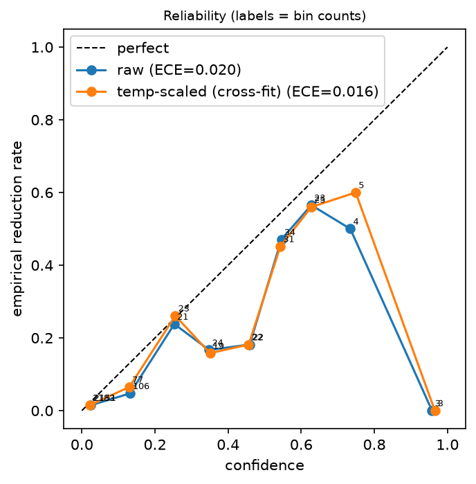
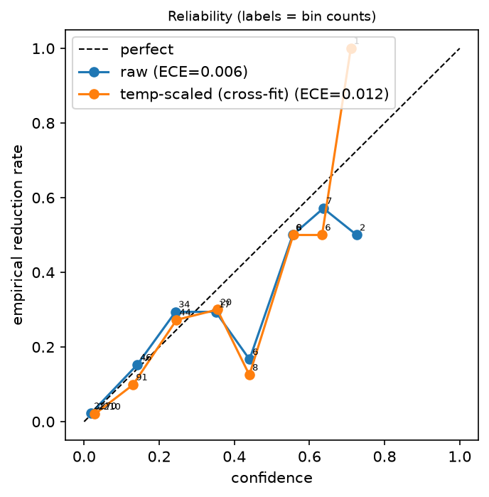

# Window ranking results

# Primary: leave-workload-out

## Window ranking + calibration (5-fold leave-workload-out CV, 3 seed(s) from 0)

- Labels: 81 reducible / 2307 not-reducible; timeouts counted as not-reducible. 'Not reducible' means no reduction found within the gate set, angle pool and time budget, not provably optimal.
- Positives come from 36 of 74 circuits; rule candidates cover 51/81 positives.
- Folds: sibling instances (e.g. grover_w5_i1/i2) share a fold, so near-duplicates cannot leak.
- ± is the std over CV seeds / tie-breaks only; it does not capture the small number of positive circuits, so treat differences of a few points as noise.
- P@k pools hits over circuits (each circuit contributes min(k, #windows) slots). Rule-based scores are heavily tied, so its P@1 is an expectation over random tie-breaks.
- Calibration (pooled out-of-fold; T cross-fitted, each fold's T fitted on the other folds' logits): mean T = 0.967 ± 0.099; NLL 0.1333 -> 0.1429; Brier 0.0295 -> 0.0300 (constant base-rate Brier = 0.0328); ECE 0.0193 -> 0.0190. Temperature scaling is monotone, so it does not change ranking metrics.
- ECE uses 10 equal-width bins and only 81 positives, so most bins are nearly empty; treat it as indicative, not conclusive.

Base rate of reducible windows: 81/2388

### Ranking (all circuits; AP/AUROC pooled over windows)

| System | P@1 | P@3 | P@5 | AP | AUROC |
|---|---|---|---|---|---|
| Random | 0.044 ± 0.003 | 0.043 ± 0.001 | 0.043 ± 0.000 | 0.037 ± 0.001 | 0.500 ± 0.000 |
| Rule-based (candidates in window) | 0.293 ± 0.001 | 0.179 ± 0.001 | 0.129 ± 0.001 | 0.263 ± 0.001 | 0.792 ± 0.000 |
| Window length only | 0.075 ± 0.004 | 0.078 ± 0.003 | 0.070 ± 0.000 | 0.081 ± 0.001 | 0.754 ± 0.000 |
| GNN window head | 0.306 ± 0.017 | 0.186 ± 0.006 | 0.140 ± 0.004 | 0.268 ± 0.049 | 0.801 ± 0.077 |
| Rule + GNN tie-break | 0.338 ± 0.011 | 0.189 ± 0.002 | 0.143 ± 0.001 | 0.329 ± 0.034 | 0.863 ± 0.044 |
| GNN (no rule features) | 0.122 ± 0.040 | 0.097 ± 0.017 | 0.091 ± 0.011 | 0.098 ± 0.040 | 0.666 ± 0.070 |

### P@k restricted to circuits with at least one positive window

| System | P@1* | P@3* | P@5* |
|---|---|---|---|
| Random | 0.100 ± 0.007 | 0.089 ± 0.002 | 0.090 ± 0.001 |
| Rule-based (candidates in window) | 0.621 ± 0.007 | 0.371 ± 0.003 | 0.264 ± 0.001 |
| Window length only | 0.165 ± 0.004 | 0.158 ± 0.004 | 0.141 ± 0.000 |
| GNN window head | 0.630 ± 0.035 | 0.380 ± 0.013 | 0.283 ± 0.009 |
| Rule + GNN tie-break | 0.694 ± 0.023 | 0.386 ± 0.004 | 0.291 ± 0.003 |
| GNN (no rule features) | 0.250 ± 0.082 | 0.198 ± 0.035 | 0.185 ± 0.023 |

### Top-1 hits (expected number of circuits whose top window is reducible)

Denominators: 74 circuits (all), 36 circuits with a positive (*).

| System | hits@1 (all) | hits@1* (positive circuits) |
|---|---|---|
| Random | 3.267 ± 0.246 | 3.583 ± 0.246 |
| Rule-based (candidates in window) | 21.667 ± 0.085 | 22.350 ± 0.248 |
| Window length only | 5.567 ± 0.295 | 5.933 ± 0.143 |
| GNN window head | 22.667 ± 1.247 | 22.667 ± 1.247 |
| Rule + GNN tie-break | 25.000 ± 0.816 | 25.000 ± 0.816 |
| GNN (no rule features) | 9.000 ± 2.944 | 9.000 ± 2.944 |

### Per-family GNN AUROC (families with positives)

| Family | Positives | GNN AUROC (out-of-fold) |
|---|---|---|
| grover | 12 | 0.742 ± 0.131 |
| rand_cliffordrz | 8 | 0.703 ± 0.158 |
| rand_cliffordt | 15 | 0.803 ± 0.008 |
| rand_cnotpauli | 38 | 0.798 ± 0.026 |
| rand_cxrz | 8 | 0.832 ± 0.127 |

### Paired bootstrap over circuits (seed-averaged scores, 1000 resamples, 95% CI)

| A vs B | ΔAP | ΔAUROC | ΔP@1 |
|---|---|---|---|
| GNN window head vs Rule-based (candidates in window) | +0.039 [-0.066, +0.155] | +0.070 [-0.006, +0.133] | +0.039 [-0.027, +0.122] |
| Rule + GNN tie-break vs Rule-based (candidates in window) | +0.071 [+0.030, +0.122] | +0.096 [+0.050, +0.140] | +0.039 [-0.027, +0.108] |
| Rule + GNN tie-break vs GNN window head | +0.033 [-0.054, +0.114] | +0.025 [-0.001, +0.074] | +0.000 [-0.041, +0.041] |
| GNN window head vs GNN (no rule features) | +0.162 [+0.051, +0.289] | +0.127 [+0.064, +0.193] | +0.162 [+0.068, +0.270] |

A CI that spans 0 means the difference is not distinguishable from noise at this circuit count.

# Secondary: leave-family-out

## Window ranking + calibration (8-fold leave-family-out CV, 3 seed(s) from 0)

- Labels: 81 reducible / 2307 not-reducible; timeouts counted as not-reducible. 'Not reducible' means no reduction found within the gate set, angle pool and time budget, not provably optimal.
- Positives come from 36 of 74 circuits; rule candidates cover 51/81 positives.
- Folds: whole families are held out together.
- ± is the std over CV seeds / tie-breaks only; it does not capture the small number of positive circuits, so treat differences of a few points as noise.
- P@k pools hits over circuits (each circuit contributes min(k, #windows) slots). Rule-based scores are heavily tied, so its P@1 is an expectation over random tie-breaks.
- Calibration (pooled out-of-fold; T cross-fitted, each fold's T fitted on the other folds' logits): mean T = 1.308 ± 0.146; NLL 0.1551 -> 0.1485; Brier 0.0302 -> 0.0310 (constant base-rate Brier = 0.0328); ECE 0.0132 -> 0.0121. Temperature scaling is monotone, so it does not change ranking metrics.
- ECE uses 10 equal-width bins and only 81 positives, so most bins are nearly empty; treat it as indicative, not conclusive.

Base rate of reducible windows: 81/2388

### Ranking (all circuits; AP/AUROC pooled over windows)

| System | P@1 | P@3 | P@5 | AP | AUROC |
|---|---|---|---|---|---|
| Random | 0.044 ± 0.003 | 0.043 ± 0.001 | 0.043 ± 0.000 | 0.037 ± 0.001 | 0.500 ± 0.000 |
| Rule-based (candidates in window) | 0.293 ± 0.001 | 0.179 ± 0.001 | 0.129 ± 0.001 | 0.263 ± 0.001 | 0.792 ± 0.000 |
| Window length only | 0.075 ± 0.004 | 0.078 ± 0.003 | 0.070 ± 0.000 | 0.081 ± 0.001 | 0.754 ± 0.000 |
| GNN window head | 0.270 ± 0.011 | 0.152 ± 0.009 | 0.110 ± 0.002 | 0.181 ± 0.046 | 0.667 ± 0.064 |
| Rule + GNN tie-break | 0.302 ± 0.013 | 0.179 ± 0.004 | 0.130 ± 0.003 | 0.295 ± 0.011 | 0.770 ± 0.032 |
| GNN (no rule features) | 0.077 ± 0.006 | 0.068 ± 0.004 | 0.058 ± 0.003 | 0.036 ± 0.007 | 0.462 ± 0.105 |

### P@k restricted to circuits with at least one positive window

| System | P@1* | P@3* | P@5* |
|---|---|---|---|
| Random | 0.100 ± 0.007 | 0.089 ± 0.002 | 0.090 ± 0.001 |
| Rule-based (candidates in window) | 0.621 ± 0.007 | 0.371 ± 0.003 | 0.264 ± 0.001 |
| Window length only | 0.165 ± 0.004 | 0.158 ± 0.004 | 0.141 ± 0.000 |
| GNN window head | 0.556 ± 0.023 | 0.312 ± 0.019 | 0.222 ± 0.005 |
| Rule + GNN tie-break | 0.620 ± 0.026 | 0.367 ± 0.009 | 0.263 ± 0.007 |
| GNN (no rule features) | 0.157 ± 0.013 | 0.139 ± 0.008 | 0.119 ± 0.007 |

### Top-1 hits (expected number of circuits whose top window is reducible)

Denominators: 74 circuits (all), 36 circuits with a positive (*).

| System | hits@1 (all) | hits@1* (positive circuits) |
|---|---|---|
| Random | 3.267 ± 0.246 | 3.583 ± 0.246 |
| Rule-based (candidates in window) | 21.667 ± 0.085 | 22.350 ± 0.248 |
| Window length only | 5.567 ± 0.295 | 5.933 ± 0.143 |
| GNN window head | 20.000 ± 0.816 | 20.000 ± 0.816 |
| Rule + GNN tie-break | 22.333 ± 0.943 | 22.333 ± 0.943 |
| GNN (no rule features) | 5.667 ± 0.471 | 5.667 ± 0.471 |

### Per-family GNN AUROC (families with positives)

| Family | Positives | GNN AUROC (out-of-fold) |
|---|---|---|
| grover | 12 | 0.800 ± 0.010 |
| rand_cliffordrz | 8 | 0.627 ± 0.080 |
| rand_cliffordt | 15 | 0.670 ± 0.035 |
| rand_cnotpauli | 38 | 0.660 ± 0.010 |
| rand_cxrz | 8 | 0.741 ± 0.094 |

### Paired bootstrap over circuits (seed-averaged scores, 1000 resamples, 95% CI)

| A vs B | ΔAP | ΔAUROC | ΔP@1 |
|---|---|---|---|
| GNN window head vs Rule-based (candidates in window) | -0.033 [-0.160, +0.091] | -0.113 [-0.185, -0.051] | -0.016 [-0.108, +0.068] |
| Rule + GNN tie-break vs Rule-based (candidates in window) | +0.037 [+0.002, +0.080] | -0.040 [-0.081, -0.002] | +0.012 [-0.041, +0.068] |
| Rule + GNN tie-break vs GNN window head | +0.070 [-0.034, +0.176] | +0.073 [+0.023, +0.146] | +0.028 [-0.041, +0.108] |
| GNN window head vs GNN (no rule features) | +0.194 [+0.110, +0.276] | +0.108 [+0.005, +0.212] | +0.202 [+0.108, +0.297] |

A CI that spans 0 means the difference is not distinguishable from noise at this circuit count.

## Plots

_Plots above show seed 0 only. Cite the pooled 3-seed ECE in the header; per-seed bins hold as few as 1-5 windows._

