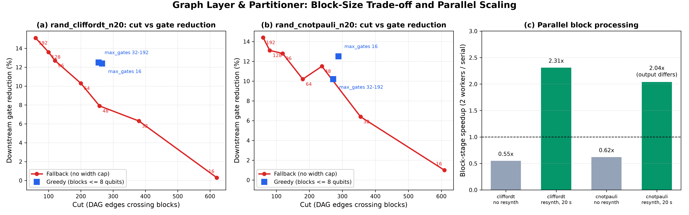

# Graph Layer & Partitioner

Report section for issue #48, handed to Swaraj for the final report (#44). Section 6 is analytical until the #47 profiling results are added; items marked **[TODO]** are still open.

## 1. Overview

The graph layer turns a parsed circuit into structures the optimizer can reason about, then cuts it into blocks that Modules A (RL scheduling), B (rule/GNN rewriting) and C (verification, resynthesis) process independently. The pipeline is: parser/IR → DAG → hypergraph → partitioner → block scheduling → per-block optimization → recombination.

## 2. DAG construction

The DAG (`qco/graphs/dag.py`) has one node per gate, indexed by its position in the circuit, and an edge `i → j` when gate `j` is the next gate to touch a qubit that gate `i` last touched. `build_dag` makes one pass over the gates with a last-writer table per qubit, so a gate on k qubits adds at most k edges. Successors and predecessors are dict-of-sets, so the graph needs no NetworkX (a `to_networkx` helper exists for modules that want it).

Queries are `roots()`, `topological_order()` (Kahn's algorithm, successors visited in sorted order so the result is deterministic, raises on a cycle) and `critical_path_length()`, which equals `IntermediateRepresentation.depth()`; tests check this on a GHZ chain and a two-wire case.

Two properties belong in the report:

- **Edges are deduplicated.** Two gates that share two qubits (for example two CX on the same pair) are joined by one edge, not two. The DAG counts dependencies between gates, not qubit wires, and `cut_size` inherits that.
- **The DAG encodes strict wire order, not commutation.** Commutation is a separate helper, `commutes(a, b)`. Each gate lists, per qubit, the Pauli it commutes with (CX: Z on the control, X on the target; RZZ: Z on both; H: none). Two gates commute if, on every qubit they share, both commute with the same Pauli. The rule is sufficient, not necessary: `False` means "not proven". A test checks all 29 × 29 gate pairs in every qubit-overlap layout and compares `a·b` with `b·a` exactly on dense unitaries. The comparison is exact rather than up to global phase because X·Z = −Z·X would wrongly pass a phase-insensitive check.

## 3. Hypergraph

The hypergraph (`qco/graphs/hypergraph.py`) has one vertex per qubit and one hyperedge per multi-qubit gate. Single-qubit gates add nothing because they couple no qubits. A hyperedge is the gate's qubit set, weighted by the gate's cost in CX equivalents: SWAP 3, RXX/RYY/RZZ 2, CCX 6, CSWAP 8, every other gate 1. Hyperedges with the same qubit set are merged and their weights summed, so repeated CX gates on one pair become a single edge whose weight is the repeat count. The weights make a cut-minimising partitioner avoid separating the expensive interactions first, and Stage 6 reuses them as the basis-independent `cx_cost` metric.

An optional `window` argument groups the multi-qubit gates inside each window of that many gates into connected components by shared qubits and emits one hyperedge per component: a coarser, smaller hypergraph. `to_kahypar_hmetis()` writes the hMETIS format KaHyPar reads (header `edges vertices 1`, vertices numbered from 1).

The hypergraph is built only by the opt-in `metis` and `kahypar` partitioners. The default `greedy` backend and `fallback` never build it.

## 4. Partitioning

The partitioner splits the circuit into blocks bounded by `max_block_qubits` and `max_block_gates`. Two backends were compared in #46 on four benchmarks (ghz_n20, ghz_n40, rand_cliffordt_n20 with 662 gates, rand_cnotpauli_n20 with 625 gates), using `benchmarks/tune_partition.py --downstream`. METIS was not installable in the test environment, so it is absent from the comparison.

- **greedy** grows blocks along the circuit until the qubit or gate cap is hit.
- **fallback** cuts contiguous gate chunks.

### 4.1 Results

Metrics: number of blocks, cut (DAG edges crossing block boundaries; parallel edges between the same two gates count once), block-size mean and standard deviation, block width (qubits touched), and downstream gate reduction after the default hybrid pipeline (rule/CR plus verification, no resynthesis, no GNN, EA off).

| Circuit | Backend (max qubits 8) | Blocks | Cut | Gate reduction |
|---|---|---|---|---|
| rand_cliffordt_n20 | greedy, any `max_block_gates` ≥ 32 | 60 | 255 | 12.5 % |
| rand_cliffordt_n20 | fallback, 16 gates | 42 | 621 | 0.3 % |
| rand_cliffordt_n20 | fallback, 64 gates | 11 | 200 | 10.3 % |
| rand_cliffordt_n20 | fallback, 192 gates | 4 | 60 | 15.1 % |
| rand_cnotpauli_n20 | greedy, any `max_block_gates` ≥ 32 | 54 | 272 | 10.2 % |
| rand_cnotpauli_n20 | fallback, 16 gates | 40 | 609 | 1.0 % |
| rand_cnotpauli_n20 | fallback, 64 gates | 10 | 180 | 10.2 % |
| rand_cnotpauli_n20 | fallback, 192 gates | 4 | 60 | 14.4 % |

*Figure 1. (a, b) Cut against downstream gate reduction; fallback points are labelled with `max_block_gates`. (c) Block-stage speedup with 2 workers. Generated by `scripts/plot_graph_layer_summary.py` from `docs/partitioner_tuning.md` and `docs/parallel_blocks.md`.*

### 4.2 Findings

1. **Greedy is capped by qubits, not gates.** With `max_block_qubits=8`, any `max_block_gates` of 32 or more gives the same partition. Dropping the qubit cap to 6 gives more, smaller blocks (78 blocks on both random circuits) with larger cuts (278 and 297). Block sizes are uneven (standard deviation 5–7 gates, many 1-gate blocks).
2. **Fallback gives even blocks but larger cuts.** Standard deviation is 1.5–3 gates at 16–48 gates per block, but the cut is 2–3x larger at comparable block counts.
3. **Gate reduction grows with block size.** Larger blocks let more gates cancel: fallback goes from 0.3–1.0 % at 16 gates to 14–15 % at 192 gates, against a flat 10–12.5 % for greedy. The price is pipeline time, which rises with block size (fallback on rand_cliffordt_n20: 5.9 s at 16 gates, 9.1 s at 192; timings are from a shared 2-core machine, so read them as relative).
4. **GHZ circuits cannot benefit.** They are a pure chain (width equals qubit count, depth equals gate count), so no setting reduces gates.
5. **Recommendation: keep the defaults** (greedy, 64 gates, 8 qubits). `max_block_gates` is not the lever for greedy. If gate reduction on large circuits matters more than speed, fallback with 128–192 gates is the option to evaluate. Defaults were deliberately left unchanged because changing them would shift every other module's numbers.

### 4.3 The fallback has no width cap

The fallback has no width cap by design: the `partitioning.py` module docstring says so, and the tests skip the width check for it. The 16–20 qubit blocks in the tuning table are expected, not a bug. Three consequences are still worth stating:

- `partition_circuit` documents `max_block_qubits` as a cap for every backend, but the fallback ignores it. The docstring now says so.
- The pipeline verifies each block after compacting it to its active qubits, and dense checking stops at 8 qubits. Wide fallback blocks should therefore come back "unverified", and rewrites that need a check (the Module A schedule, GNN extras) are rejected. **[TODO: confirm in `EquivalenceChecker`.]**
- If so, the fallback's higher gate reduction in the tuning table (up to 15 %) comes mostly from rule-proven cancellations, which skip verification, inside larger blocks. It is not a like-for-like comparison with greedy, whose blocks are all verifiable. Findings 3 and 5 above should carry that caveat.

## 5. Block scheduling and parallel processing

`PipelineConfig.parallel_blocks` (default 1, serial) runs the per-block Stage 4 work in forked worker processes: Module A scheduling, Module B, Module C verification and window resynthesis. The entry point is `HybridOptimizer.optimize_blocks(blocks, workers=None)`, which returns the verified variants of every block in block order. Forked workers inherit the optimizer copy-on-write (trained policy, GNN, checkers); only chunks of blocks go in, and variants plus audit deltas come back. Threads would not help because of the GIL. Without `fork` (Windows), it warns and runs serially.

### 5.1 Identity with serial

Tests check identical Pareto circuits and identical audit counters on rand_cliffordt_n20 without resynthesis, and with exhaustive-ranking resynthesis on a small circuit. The solver budget is wall-clock based, so identity is guaranteed only when the budget is not binding. With a binding budget, each parallel block gets `budget / n_blocks` while serial is first-come, so outputs can differ.

### 5.2 Measured speedup (2 cores, block stage, median of 3)

| Circuit | Mode | Workers | Block stage (s) | Speedup | Identical to serial |
|---|---|---|---|---|---|
| rand_cliffordt_n20 | no resynthesis | 1 | 1.229 | 1.00x | yes |
| rand_cliffordt_n20 | no resynthesis | 2 | 2.217 | 0.55x | yes |
| rand_cliffordt_n20 | resynthesis, 20 s budget | 1 | 21.776 | 1.00x | yes |
| rand_cliffordt_n20 | resynthesis, 20 s budget | 2 | 9.409 | 2.31x | yes |
| rand_cnotpauli_n20 | no resynthesis | 1 | 1.906 | 1.00x | yes |
| rand_cnotpauli_n20 | no resynthesis | 2 | 3.060 | 0.62x | yes |
| rand_cnotpauli_n20 | resynthesis, 20 s budget | 1 | 21.802 | 1.00x | yes |
| rand_cnotpauli_n20 | resynthesis, 20 s budget | 2 | 10.702 | 2.04x | no |

- **Without resynthesis, parallel is slower (0.55–0.62x).** Blocks cost about 25 ms each, so fork, pickling and merging outweigh the savings.
- **With resynthesis, 2.0–2.3x, but not a clean speedup.** Serial spends the whole 20 s budget, while parallel blocks each get a smaller share and finish earlier, so less solver work is done. The rand_cnotpauli_n20 run differs from serial for exactly that reason. A like-for-like speedup needs a non-binding budget, which was too slow to run on the test machine.
- **Conclusion:** parallelism pays off only when resynthesis dominates. The default stays serial.

Reproduce with `python benchmarks/bench_parallel.py --workers 1 2 --repeat 3`.

## 6. Complexity and profiling (#47)

Sahib's #47 measurements were not on any branch in the git output, so this table is derived from reading the source. Replace it with measured exponents, and add the profiling plots, when #47 lands. G = gates, k ≤ 3 = largest gate arity, B = `max_block_gates`.

| Step | Time | Extra memory | Basis |
|---|---|---|---|
| DAG build | O(G·k) | O(G·k) | one pass, at most k edges per gate |
| Topological order | O(G·k log k) | O(G) | Kahn's algorithm, successors sorted |
| Critical path | O(G·k) | O(G) | one pass over the topological order |
| Hypergraph, no window | O(G·k) | O(G) | one hyperedge per multi-qubit gate, merged by qubit set |
| Hypergraph, window w | O(G·w) | O(G) | each gate scans the groups in its window |
| Greedy partition | O(G·B) | O(G) | each gate re-sorts a merged id list of at most B items |
| Fallback partition | O(G·k·log G) | O(G) | DAG, union-find (path compression, no union by rank), then chunking |
| METIS / KaHyPar | O(G·k²) + solver | O(G·k²) | clique expansion, then the greedy sweep |
| `cut_size` | O(G·k) | O(G·k) | rebuilds the DAG |
| `schedule_blocks`, `stitch_blocks` | O(G·k + b log b) | O(G·k) | each rebuilds the DAG; b = number of blocks |

The parser (`from_qasm2`) makes one pass over the text, so it is linear in the file size, with a few regex matches per gate line and one `eval` per parameter; memory is O(G). This is also from reading, not measurement.

Everything in the graph layer is linear in the gate count for fixed k and B. The tuning run backs this up: partitioning took 0.1–12 ms per circuit while the whole pipeline took 5–13 s, so `partition_circuit` alone is under 1 % of pipeline time. The other graph-layer calls (the DAG rebuilds in `cut_size`, `schedule_blocks` and `stitch_blocks`) were not timed separately. For greedy, blocks never exceeded 30 gates on these two circuits because the qubit cap binds first, which is why `max_block_gates` ≥ 32 changes nothing.

One thing worth profiling: `cut_size`, `schedule_blocks` and `stitch_blocks` each rebuild the DAG, and with resynthesis on, `_resynthesize_windows` calls `schedule_blocks` and `stitch_blocks` for every block. File a hotspot issue only if #47 shows it matters.

## 7. Final graph-layer bug fixes

These problems were found by reading `dag.py`, `hypergraph.py`, `partitioning.py`, `intermediate_representation.py`, `parser.py` and `pipeline.py`. Each fix is covered by a test in `tests/test_graph_layer_fixes.py`. None changes a number in the #46 tables.

| # | Finding | Where | Fix |
|---|---|---|---|
| 1 | `cut_size` is documented as counting qubit wires, but `build_dag` stores edges in sets, so two gates sharing two qubits count once | `dag.py` `add_edge`, `partitioning.py` `cut_size` | Docstring now says "DAG edges". The count is unchanged, because changing it would shift every cut in the tuning tables. |
| 2 | `partition_circuit` documents both caps for every backend, but `fallback` ignores `max_block_qubits` | `partitioning.py` | Docstring now says so (section 4.3). |
| 3 | `max_block_qubits=0` raised `ZeroDivisionError` even for greedy, because `k` is computed before the backend branch; `max_block_gates=0` with fallback raised a `range()` step error | `partition_circuit`, `_fallback_partition` | Both are validated as ≥ 1 with a clear `ValueError`. |
| 4 | `Gate` accepted repeated qubits (`cx` on `(0, 0)`) and negative indices; only `IR.add` bounds-checks, and only the upper range | `Gate.__post_init__` | Duplicates and negatives are rejected. |
| 5 | `Counter`, `dataclass` and `field` were imported twice | top of `partitioning.py` | Duplicate lines removed. |
| 6 | Edge cases: an empty circuit through the partitioner; a circuit with no multi-qubit gates through `metis` or `kahypar` (empty hypergraph, header `0 n 1`) | tests | Tests added and pass on the current code, so no fix was needed. |

**Status.** Items 1–5 were fixed and are covered by `tests/test_graph_layer_fixes.py` (12 tests, all passing); the full suite passes with no failures. Commit: da4677c.

Reviewing `parser.py` also turned up four bugs, each reproduced by a failing test before the fix:

- **Inline comments:** `h q[0]; // note` silently dropped the gate.
- **Commented-out `qreg`:** a `// qreg x[3];` line was still counted, which both inflated the qubit count and moved later gates onto the wrong qubits (`h q[0]` landed on qubit 3).
- **Unparseable lines:** a line the gate regex could not match, such as `rz((pi)/2) q[0];`, was skipped with no error. It now raises `ValueError`.
- **Power expressions:** `rz(9**9**9**9)` passed the parameter filter and hung `eval`. It is now rejected.

One more change comes from reading only and is not covered by a test yet (the Qiskit tests ran, but none uses a conditioned gate): `from_qiskit` now rejects classically conditioned gates instead of treating them as unconditional.

## 8. Limitations and open items

- METIS and KaHyPar rows are missing from the partitioner comparison because they were not installable. Rerun `benchmarks/tune_partition.py` with pymetis installed. The METIS partition tests are also skipped in the local test run for the same reason.
- Parallel speedup under a non-binding solver budget is unmeasured, and the parallel-block tests are skipped on Windows (no `fork`).
- All timings come from a shared 2-core machine and are relative, not absolute.
- The Big-O table in section 6 is analytical; measured profiling from #47 is still to be added.
- Hand-off for the integration issue (#36): call `optimize_blocks` and keep `parallel_blocks=1` unless resynthesis dominates.