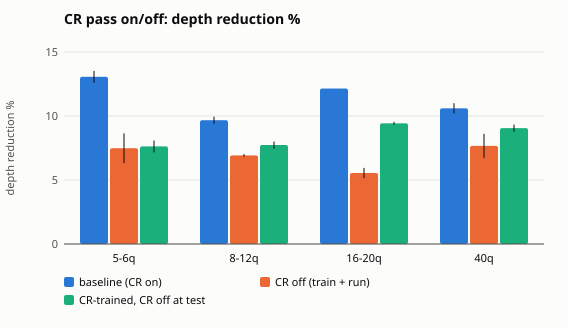
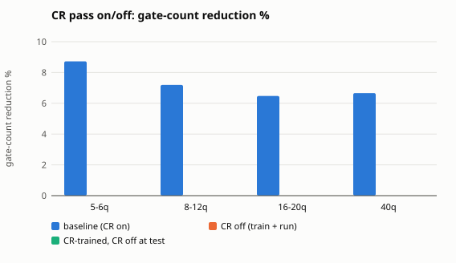
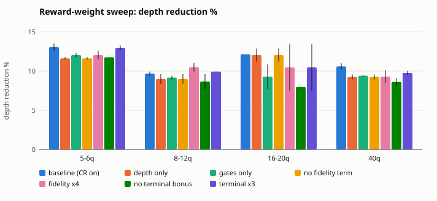
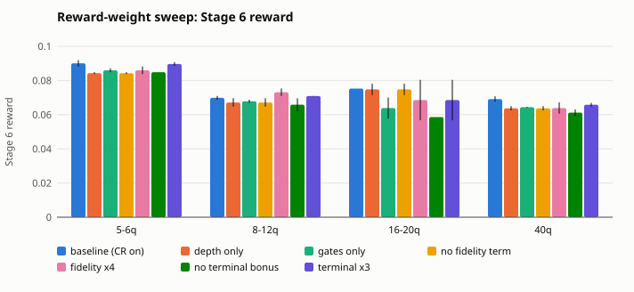

# Module A ablations (issue #37)

Policies trained on generated 5-qubit circuits (40000 timesteps, seeds [0, 1], `configs/rl_ppo_5q.yaml`), run greedily on the benchmark circuits (`benchmarks/circuits` up to 20 qubits, `benchmarks/circuits_40q` + `ghz_n40` at 40). Values are mean ± std over seeds of the per-bucket mean; metrics are variant-independent (Stage 6 reward uses its default weights).

Bucket sizes: 5-6q = 6 circuits, 8-12q = 7 circuits, 16-20q = 6 circuits, 40q = 6 circuits

## CR pass on/off

### Depth reduction %

| Variant | 5-6q | 8-12q | 16-20q | 40q |
|---|---|---|---|---|
| baseline (CR on) | 13.06 ± 0.46 | 9.67 ± 0.27 | 12.15 ± 0.00 | 10.60 ± 0.40 |
| CR off (train + run) | 7.48 ± 1.16 | 6.92 ± 0.11 | 5.54 ± 0.40 | 7.66 ± 0.95 |
| CR-trained, CR off at test | 7.62 ± 0.46 | 7.73 ± 0.27 | 9.43 ± 0.12 | 9.05 ± 0.28 |

### Gate-count reduction %

| Variant | 5-6q | 8-12q | 16-20q | 40q |
|---|---|---|---|---|
| baseline (CR on) | 8.72 ± 0.00 | 7.19 ± 0.00 | 6.47 ± 0.00 | 6.66 ± 0.00 |
| CR off (train + run) | 0.00 ± 0.00 | 0.00 ± 0.00 | 0.00 ± 0.00 | 0.00 ± 0.00 |
| CR-trained, CR off at test | 0.00 ± 0.00 | 0.00 ± 0.00 | 0.00 ± 0.00 | 0.00 ± 0.00 |

### Stage 6 scalarized reward

| Variant | 5-6q | 8-12q | 16-20q | 40q |
|---|---|---|---|---|
| baseline (CR on) | 0.090 ± 0.002 | 0.070 ± 0.001 | 0.075 ± 0.000 | 0.069 ± 0.002 |
| CR off (train + run) | 0.030 ± 0.005 | 0.028 ± 0.000 | 0.022 ± 0.002 | 0.031 ± 0.004 |
| CR-trained, CR off at test | 0.030 ± 0.002 | 0.031 ± 0.001 | 0.038 ± 0.000 | 0.036 ± 0.001 |

## Reward-weight sweep

### Depth reduction %

| Variant | 5-6q | 8-12q | 16-20q | 40q |
|---|---|---|---|---|
| baseline (CR on) | 13.06 ± 0.46 | 9.67 ± 0.27 | 12.15 ± 0.00 | 10.60 ± 0.40 |
| depth only | 11.63 ± 0.14 | 9.00 ± 0.61 | 12.03 ± 0.83 | 9.25 ± 0.32 |
| gates only | 12.04 ± 0.28 | 9.17 ± 0.23 | 9.29 ± 1.55 | 9.41 ± 0.08 |
| no fidelity term | 11.63 ± 0.14 | 9.00 ± 0.61 | 12.03 ± 0.83 | 9.25 ± 0.32 |
| fidelity x4 | 12.04 ± 0.56 | 10.50 ± 0.55 | 10.47 ± 2.96 | 9.29 ± 0.83 |
| no terminal bonus | 11.76 ± 0.00 | 8.67 ± 0.94 | 7.98 ± 0.00 | 8.62 ± 0.48 |
| terminal x3 | 12.97 ± 0.28 | 9.93 ± 0.01 | 10.47 ± 2.96 | 9.76 ± 0.28 |

### Gate-count reduction %

| Variant | 5-6q | 8-12q | 16-20q | 40q |
|---|---|---|---|---|
| baseline (CR on) | 8.72 ± 0.00 | 7.19 ± 0.00 | 6.47 ± 0.00 | 6.66 ± 0.00 |
| depth only | 8.72 ± 0.00 | 7.19 ± 0.00 | 6.47 ± 0.00 | 6.66 ± 0.00 |
| gates only | 8.72 ± 0.00 | 7.19 ± 0.00 | 6.47 ± 0.00 | 6.66 ± 0.00 |
| no fidelity term | 8.72 ± 0.00 | 7.19 ± 0.00 | 6.47 ± 0.00 | 6.66 ± 0.00 |
| fidelity x4 | 8.72 ± 0.00 | 7.19 ± 0.00 | 6.47 ± 0.00 | 6.66 ± 0.00 |
| no terminal bonus | 8.72 ± 0.00 | 7.19 ± 0.00 | 6.47 ± 0.00 | 6.66 ± 0.00 |
| terminal x3 | 8.72 ± 0.00 | 7.19 ± 0.00 | 6.47 ± 0.00 | 6.66 ± 0.00 |

### Stage 6 scalarized reward

| Variant | 5-6q | 8-12q | 16-20q | 40q |
|---|---|---|---|---|
| baseline (CR on) | 0.090 ± 0.002 | 0.070 ± 0.001 | 0.075 ± 0.000 | 0.069 ± 0.002 |
| depth only | 0.084 ± 0.001 | 0.067 ± 0.002 | 0.075 ± 0.003 | 0.064 ± 0.001 |
| gates only | 0.086 ± 0.001 | 0.068 ± 0.001 | 0.064 ± 0.006 | 0.064 ± 0.000 |
| no fidelity term | 0.084 ± 0.001 | 0.067 ± 0.002 | 0.075 ± 0.003 | 0.064 ± 0.001 |
| fidelity x4 | 0.086 ± 0.002 | 0.073 ± 0.002 | 0.069 ± 0.012 | 0.064 ± 0.003 |
| no terminal bonus | 0.085 ± 0.000 | 0.066 ± 0.004 | 0.059 ± 0.000 | 0.061 ± 0.002 |
| terminal x3 | 0.090 ± 0.001 | 0.071 ± 0.000 | 0.069 ± 0.012 | 0.066 ± 0.001 |

## Per circuit (mean over seeds): depth / gate reduction %

| Circuit | qubits | baseline (CR on) | CR off (train + run) | depth only | gates only | no fidelity term | fidelity x4 | no terminal bonus | terminal x3 | CR-trained, CR off at test |
|---|---|---|---|---|---|---|---|---|---|---|
| ghz_n10 | 10 | 0.0 / 0.0 | 0.0 / 0.0 | 0.0 / 0.0 | 0.0 / 0.0 | 0.0 / 0.0 | 0.0 / 0.0 | 0.0 / 0.0 | 0.0 / 0.0 | 0.0 / 0.0 |
| ghz_n20 | 20 | 0.0 / 0.0 | 0.0 / 0.0 | 0.0 / 0.0 | 0.0 / 0.0 | 0.0 / 0.0 | 0.0 / 0.0 | 0.0 / 0.0 | 0.0 / 0.0 | 0.0 / 0.0 |
| ghz_n5 | 5 | 0.0 / 0.0 | 0.0 / 0.0 | 0.0 / 0.0 | 0.0 / 0.0 | 0.0 / 0.0 | 0.0 / 0.0 | 0.0 / 0.0 | 0.0 / 0.0 | 0.0 / 0.0 |
| qaoa_n10_p1 | 10 | 21.2 / 0.0 | 19.2 / 0.0 | 19.2 / 0.0 | 21.2 / 0.0 | 19.2 / 0.0 | 26.9 / 0.0 | 15.4 / 0.0 | 25.0 / 0.0 | 21.2 / 0.0 |
| qaoa_n10_p2 | 10 | 19.4 / 0.0 | 19.4 / 0.0 | 16.7 / 0.0 | 16.7 / 0.0 | 16.7 / 0.0 | 19.4 / 0.0 | 16.7 / 0.0 | 16.7 / 0.0 | 19.4 / 0.0 |
| qaoa_n16_p1 | 16 | 25.0 / 0.0 | 0.0 / 0.0 | 25.0 / 0.0 | 10.0 / 0.0 | 25.0 / 0.0 | 12.5 / 0.0 | 0.0 / 0.0 | 12.5 / 0.0 | 25.0 / 0.0 |
| qaoa_n16_p2 | 16 | 16.7 / 0.0 | 19.8 / 0.0 | 16.7 / 0.0 | 16.7 / 0.0 | 16.7 / 0.0 | 19.8 / 0.0 | 16.7 / 0.0 | 19.8 / 0.0 | 16.7 / 0.0 |
| qaoa_n6_p1 | 6 | 25.0 / 0.0 | 22.5 / 0.0 | 20.0 / 0.0 | 22.5 / 0.0 | 20.0 / 0.0 | 22.5 / 0.0 | 20.0 / 0.0 | 22.5 / 0.0 | 25.0 / 0.0 |
| qaoa_n6_p2 | 6 | 13.9 / 0.0 | 13.9 / 0.0 | 11.1 / 0.0 | 11.1 / 0.0 | 11.1 / 0.0 | 11.1 / 0.0 | 11.1 / 0.0 | 16.7 / 0.0 | 13.9 / 0.0 |
| qft_n12 | 12 | 0.0 / 0.0 | 0.0 / 0.0 | 0.0 / 0.0 | 0.0 / 0.0 | 0.0 / 0.0 | 0.0 / 0.0 | 0.0 / 0.0 | 0.0 / 0.0 | 0.0 / 0.0 |
| qft_n16 | 16 | 0.0 / 0.0 | 0.0 / 0.0 | 0.0 / 0.0 | 0.0 / 0.0 | 0.0 / 0.0 | 0.0 / 0.0 | 0.0 / 0.0 | 0.0 / 0.0 | 0.0 / 0.0 |
| qft_n5 | 5 | 0.0 / 0.0 | 0.0 / 0.0 | 0.0 / 0.0 | 0.0 / 0.0 | 0.0 / 0.0 | 0.0 / 0.0 | 0.0 / 0.0 | 0.0 / 0.0 | 0.0 / 0.0 |
| qft_n8 | 8 | 0.0 / 0.0 | 0.0 / 0.0 | 0.0 / 0.0 | 0.0 / 0.0 | 0.0 / 0.0 | 0.0 / 0.0 | 0.0 / 0.0 | 0.0 / 0.0 | 0.0 / 0.0 |
| rand_cliffordt_n10 | 10 | 16.7 / 28.3 | 4.5 / 0.0 | 16.7 / 28.3 | 15.9 / 28.3 | 16.7 / 28.3 | 16.7 / 28.3 | 17.4 / 28.3 | 17.4 / 28.3 | 6.1 / 0.0 |
| rand_cliffordt_n20 | 20 | 17.1 / 22.2 | 6.4 / 0.0 | 15.7 / 22.2 | 15.0 / 22.2 | 15.7 / 22.2 | 15.7 / 22.2 | 17.1 / 22.2 | 16.4 / 22.2 | 7.9 / 0.0 |
| rand_cliffordt_n5 | 5 | 16.7 / 27.2 | 5.0 / 0.0 | 15.8 / 27.2 | 15.8 / 27.2 | 15.8 / 27.2 | 15.8 / 27.2 | 16.7 / 27.2 | 15.8 / 27.2 | 3.3 / 0.0 |
| rand_cnotpauli_n10 | 10 | 10.4 / 22.1 | 5.2 / 0.0 | 10.4 / 22.1 | 10.4 / 22.1 | 10.4 / 22.1 | 10.4 / 22.1 | 11.2 / 22.1 | 10.4 / 22.1 | 7.5 / 0.0 |
| rand_cnotpauli_n20 | 20 | 14.1 / 16.6 | 7.0 / 0.0 | 14.8 / 16.6 | 14.1 / 16.6 | 14.8 / 16.6 | 14.8 / 16.6 | 14.1 / 16.6 | 14.1 / 16.6 | 7.0 / 0.0 |
| rand_cnotpauli_n5 | 5 | 22.8 / 25.2 | 3.5 / 0.0 | 22.8 / 25.2 | 22.8 / 25.2 | 22.8 / 25.2 | 22.8 / 25.2 | 22.8 / 25.2 | 22.8 / 25.2 | 3.5 / 0.0 |
| qaoa_n40_p1 | 40 | 29.8 / 0.0 | 31.9 / 0.0 | 31.9 / 0.0 | 31.9 / 0.0 | 31.9 / 0.0 | 31.9 / 0.0 | 29.8 / 0.0 | 31.9 / 0.0 | 29.8 / 0.0 |
| qaoa_n40_p2 | 40 | 16.7 / 0.0 | 8.3 / 0.0 | 10.7 / 0.0 | 13.1 / 0.0 | 10.7 / 0.0 | 9.5 / 0.0 | 8.3 / 0.0 | 13.1 / 0.0 | 16.7 / 0.0 |
| qft_n40 | 40 | 0.0 / 4.3 | 0.0 / 0.0 | 0.0 / 4.3 | 0.0 / 4.3 | 0.0 / 4.3 | 0.0 / 4.3 | 0.0 / 4.3 | 0.0 / 4.3 | 0.0 / 0.0 |
| rand_cliffordt_n40 | 40 | 9.3 / 17.5 | 1.4 / 0.0 | 7.1 / 17.5 | 6.4 / 17.5 | 7.1 / 17.5 | 8.6 / 17.5 | 7.9 / 17.5 | 7.9 / 17.5 | 2.9 / 0.0 |
| rand_cnotpauli_n40 | 40 | 7.9 / 18.2 | 4.3 / 0.0 | 5.7 / 18.2 | 5.0 / 18.2 | 5.7 / 18.2 | 5.7 / 18.2 | 5.7 / 18.2 | 5.7 / 18.2 | 5.0 / 0.0 |
| ghz_n40 | 40 | 0.0 / 0.0 | 0.0 / 0.0 | 0.0 / 0.0 | 0.0 / 0.0 | 0.0 / 0.0 | 0.0 / 0.0 | 0.0 / 0.0 | 0.0 / 0.0 | 0.0 / 0.0 |
