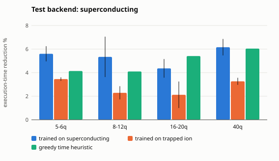
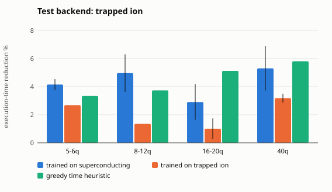

# Per-backend policies on the benchmark circuits (issue #37 / #29)

Policies from `models/backend` (trained on generated 5-qubit circuits with the time-aware reward, seeds [0, 1, 2]); metric = mean execution-time reduction (%) under the *test* backend's calibration; mean ± std over seeds. Rows = test backend, columns = backend the policy was trained on.

## 5-6 qubits (6 circuits)

| test (rows) / trained on (columns) | superconducting_ibm_like | trapped_ion_like | greedy one-step time heuristic |
|---|---|---|---|
| superconducting_ibm_like | 5.60 ± 0.65 | 3.45 ± 0.15 | 4.14 |
| trapped_ion_like | 4.15 ± 0.39 | 2.68 ± 0.00 | 3.34 |

* own-backend policy has the best mean: {'superconducting_ibm_like': True, 'trapped_ion_like': False}
* seeds (of 3) where the own-backend policy beats the other's: {'superconducting_ibm_like': 3, 'trapped_ion_like': 0}
* fraction of (circuit, test backend, seed) cases with different schedules: 0.53

## 8-12 qubits (7 circuits)

| test (rows) / trained on (columns) | superconducting_ibm_like | trapped_ion_like | greedy one-step time heuristic |
|---|---|---|---|
| superconducting_ibm_like | 5.34 ± 1.71 | 2.29 ± 0.56 | 4.10 |
| trapped_ion_like | 4.96 ± 1.34 | 1.35 ± 0.00 | 3.73 |

* own-backend policy has the best mean: {'superconducting_ibm_like': True, 'trapped_ion_like': False}
* seeds (of 3) where the own-backend policy beats the other's: {'superconducting_ibm_like': 3, 'trapped_ion_like': 0}
* fraction of (circuit, test backend, seed) cases with different schedules: 0.36

## 16-20 qubits (6 circuits)

| test (rows) / trained on (columns) | superconducting_ibm_like | trapped_ion_like | greedy one-step time heuristic |
|---|---|---|---|
| superconducting_ibm_like | 4.36 ± 0.79 | 2.12 ± 1.12 | 5.41 |
| trapped_ion_like | 2.90 ± 1.26 | 1.01 ± 0.73 | 5.12 |

* own-backend policy has the best mean: {'superconducting_ibm_like': True, 'trapped_ion_like': False}
* seeds (of 3) where the own-backend policy beats the other's: {'superconducting_ibm_like': 3, 'trapped_ion_like': 0}
* fraction of (circuit, test backend, seed) cases with different schedules: 0.44

## 40 qubits (6 circuits)

| test (rows) / trained on (columns) | superconducting_ibm_like | trapped_ion_like | greedy one-step time heuristic |
|---|---|---|---|
| superconducting_ibm_like | 6.16 ± 0.70 | 3.26 ± 0.30 | 6.04 |
| trapped_ion_like | 5.30 ± 1.58 | 3.18 ± 0.31 | 5.80 |

* own-backend policy has the best mean: {'superconducting_ibm_like': True, 'trapped_ion_like': False}
* seeds (of 3) where the own-backend policy beats the other's: {'superconducting_ibm_like': 3, 'trapped_ion_like': 0}
* fraction of (circuit, test backend, seed) cases with different schedules: 0.53

