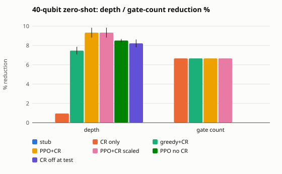

# Zero-shot generalization to 40 qubits (issue #37)

Policies from #26 (trained on generated 5-qubit circuits, 100000 timesteps, `commutation=full`), run zero-shot on 40-qubit circuits: `benchmarks/circuits_40q/` (qft, qaoa p1/p2, random Clifford+T, random CNOT+Pauli) and `ghz_n40`. Not equivalence-checked here (numeric cap is 8 qubits); see the end-to-end table for block-wise verification.

Seeds: [0, 1, 2]. Values are mean % reduction vs the raw benchmark circuit (depth, then gate count); depth is mean ± std over seeds.

## Depth reduction % by qubit bucket

| Method | 40 qubits (n=6) |
|---|---|
| greedy `schedule()` stub | 0.0 ± 0.0 |
| CR only | 1.0 ± 0.0 |
| greedy-depth + CR | 7.5 ± 0.4 |
| **PPO + CR** | 9.3 ± 0.5 |
| PPO + CR, scaled budget | 9.3 ± 0.5 |
| PPO, no CR (trained & run) | 8.5 ± 0.2 |
| CR-trained PPO, CR off at test | 8.2 ± 0.4 |

## Gate-count reduction %

| Method | 40 |
|---|---|
| greedy `schedule()` stub | 0.0 |
| CR only | 6.7 |
| greedy-depth + CR | 6.7 |
| **PPO + CR** | 6.7 |
| PPO + CR, scaled budget | 6.7 |
| PPO, no CR (trained & run) | 0.0 |
| CR-trained PPO, CR off at test | 0.0 |

## Per circuit (depth reduction %, mean over seeds)

| Circuit | qubits | gates | depth | greedy `schedule()` stub | CR only | greedy-depth + CR | **PPO + CR** | PPO + CR, scaled budget | PPO, no CR (trained & run) | CR-trained PPO, CR off at test |
|---|---|---|---|---|---|---|---|---|---|---|
| qaoa_n40_p1 | 40 | 260 | 47 | 0.0 | 0.0 | 29.1 | 31.2 | 31.2 | 29.8 | 31.2 |
| qaoa_n40_p2 | 40 | 480 | 42 | 0.0 | 0.0 | 7.1 | 11.9 | 11.9 | 15.1 | 11.9 |
| qft_n40 | 40 | 840 | 80 | 0.0 | 0.0 | 0.0 | 0.0 | 0.0 | 0.0 | 0.0 |
| rand_cliffordt_n40 | 40 | 1383 | 70 | 0.0 | 2.9 | 4.3 | 6.7 | 6.7 | 1.9 | 1.9 |
| rand_cnotpauli_n40 | 40 | 1264 | 70 | 0.0 | 2.9 | 4.3 | 6.2 | 6.2 | 4.3 | 4.3 |
| ghz_n40 | 40 | 40 | 40 | 0.0 | 0.0 | 0.0 | 0.0 | 0.0 | 0.0 | 0.0 |

Equivalence (numeric, <= 8 qubits): 0 checks, 0 failures. Circuits above 8 qubits are not equivalence-checked here (numeric backend cap; the SMT path is the follow-up).

